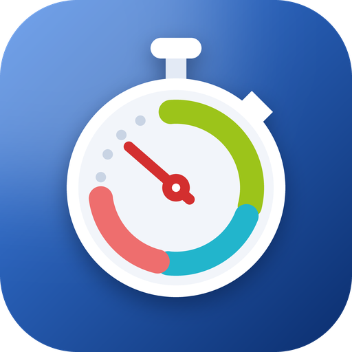

<p align="center">
  
</p>

<h1 align="center">Zwischenzeit</h1>

<p align="center"><em>Dein Praxistag, im Blick zwischen zwei Patienten.</em><br>
Your practice day, at a glance between two patients.</p>

<p align="center">

[](https://github.com/theexiile1305/zwischenzeit/actions/workflows/ci.yml)
[](https://github.com/theexiile1305/zwischenzeit/actions/workflows/codeql.yml)
[](https://scorecard.dev/viewer/?uri=github.com/theexiile1305/zwischenzeit)
[](https://www.bestpractices.dev/projects/15745)
[](LICENSE)

</p>

*Zwischenzeit* is German for a split time, and for "the time in between": the minute between
two treatments when a therapist glances at the phone or the wrist to see what is next.

A native SwiftUI appointment calendar for therapists who use the
[TTools](https://www.ttools.app) practice-management software: an iPhone/iPad app plus an
Apple Watch app and complication that show the next appointment.

> [!IMPORTANT]
> This is an **unofficial, community-built client**. It is not made, endorsed or supported by
> the vendor of TTools. "TTools" is used only to describe compatibility; all trademarks belong
> to their owners. Use it only with your own TTools account and in line with your practice's
> data-protection rules.

The user interface is German, because TTools is used in German-speaking practices.

## Features

- **Agenda, day, week and month views** of the signed-in therapist's appointments, with a
  next-up card, free gaps and pauses.
- **Check-in status**: see at a glance whether the next patient is already waiting.
- **Appointment details**: treatments, room, prescription progress (n of m sessions) with
  first/last-session hints.
- **Treatment documentation**: write the documentation text with reusable text snippets
  (Textbausteine); conflicts with edits made in TTools meanwhile are detected, not overwritten.
- **Apple Watch**: next appointment, complication and a reminder notification. Which details
  reach the watch (patient name, treatment, room) is configurable.
- **Privacy by default**: Face ID / passcode lock at launch and after 5 minutes in the
  background, privacy cover in the app switcher and during screen recording, tokens in the
  Keychain (this device only), no appointment data stored on the phone, no third-party keyboards.
  See the [threat model](docs/THREAT_MODEL.md).

### Read-only by design

The app never creates, changes or deletes data in TTools, with one exception: saving the
documentation text of an appointment. See [CLAUDE.md](CLAUDE.md#backend-contract) for the full
backend contract.

## Requirements

- macOS with **Xcode 26** or newer (Swift 6)
- [XcodeGen](https://github.com/yonaskolb/XcodeGen) (`brew install xcodegen`), only if you change `project.yml`
- iOS 17 / iPadOS 17 / watchOS 10 or newer
- For live data: a TTools account (Einrichtung, Benutzer, Passwort; optional TOTP)

## Getting started

```sh
git clone https://github.com/theexiile1305/zwischenzeit.git
cd zwischenzeit
open Zwischenzeit.xcodeproj
```

Pick the `Zwischenzeit` scheme and an iPhone simulator. To try the app without an account,
add `-mockAPI` to the scheme's launch arguments: it then runs on deterministic fake data.

### Running on your own device

The repository contains no signing identity. Copy the example config and fill in your values:

```sh
cp Config/Local.xcconfig.example Config/Local.xcconfig
# set BUNDLE_ID_PREFIX (e.g. com.yourname) and DEVELOPMENT_TEAM
```

`Config/Local.xcconfig` is git-ignored. Bundle IDs, the App Group for the watch and the
background-task identifier are all derived from `BUNDLE_ID_PREFIX`.

### Launch arguments

| Argument | Effect |
| --- | --- |
| `-mockAPI` | Fake data instead of the live backend |
| `-fixedNow <ISO8601>` | Freeze the clock (implies `-mockAPI`) |
| `-signedOut` | Mock starts signed out |
| `-watchEnabled` | Turn on watch sync |
| `-calendarMode agenda\|day\|week\|month` | Open a specific view |
| `-route settings\|firstAppointment\|documentation` | Open a specific screen |

## Development

```sh
# Unit tests (Swift Testing, no simulator or backend needed)
swift test --package-path Packages/ZwischenzeitKit

# Build the apps
xcodebuild -project Zwischenzeit.xcodeproj -scheme Zwischenzeit \
  -destination 'generic/platform=iOS Simulator' build
xcodebuild -project Zwischenzeit.xcodeproj -scheme ZwischenzeitWatch \
  -destination 'generic/platform=watchOS Simulator' build

# Screenshot with mock data and a frozen clock
scripts/screenshot.sh out.png -calendarMode week

# Design-system gallery rendered to PNG (macOS, no simulator)
swift run --package-path Packages/ZwischenzeitKit DesignGallery /tmp/gallery
```

After editing `project.yml` run `xcodegen generate`; after editing `design/tokens.json` run
`python3 scripts/gen_swift_tokens.py design/tokens.json Packages/ZwischenzeitKit/Sources/DesignSystem/DesignTokens.swift`.
Commit the generated files too; CI checks that they are in sync.

### Architecture

```
App/iOS, App/Watch, App/WatchWidgets   thin app targets
Packages/ZwischenzeitKit                     everything else (SwiftPM, Swift 6 strict concurrency)
  Domain        models, TToolsAPI protocol, errors
  LiveAPI       real backend: HTTP client, Keychain token store, DTOs, mapping
  MockAPI       deterministic fake data for previews, tests and screenshots
  CalendarFeature, AppointmentFeature, DocumentationFeature, SettingsFeature
  WatchSync, WatchUI   phone → watch payload and watch views
  DesignSystem  token-driven components (generated from design/tokens.json)
```

The watch never talks to the backend and holds no credentials: the iPhone formats today's and
tomorrow's appointments according to the privacy settings and sends them via WatchConnectivity.
[CLAUDE.md](CLAUDE.md) documents the architecture and the wire-format rules in detail.

There are no third-party dependencies, and we intend to keep it that way.

## Privacy and data handling

This app displays health data of real patients. The project follows these rules, and so must
contributions:

- No patient data, real names, notes, tokens or screenshots of live data in issues, pull
  requests, test fixtures or logs. Use `-mockAPI` for screenshots.
- Logs contain counts and decoding paths only, never names, free text or tokens.
- Nothing about appointments is persisted on the phone: the network layer runs without any
  HTTP cache or cookies. The watch keeps only the last payload, with file protection, in its
  App Group.
- Third-party keyboards are disabled inside the app, because they could send typed passwords
  or documentation text off the device. The system keyboard and dictation keep working.
- [docs/THREAT_MODEL.md](docs/THREAT_MODEL.md) lists threats, mitigations and accepted risks.

## Contributing

Contributions are welcome! Please read [CONTRIBUTING.md](CONTRIBUTING.md) and our
[Code of Conduct](CODE_OF_CONDUCT.md). For security issues, see [SECURITY.md](SECURITY.md) —
please do not open public issues for vulnerabilities.

## License

[MIT](LICENSE)
